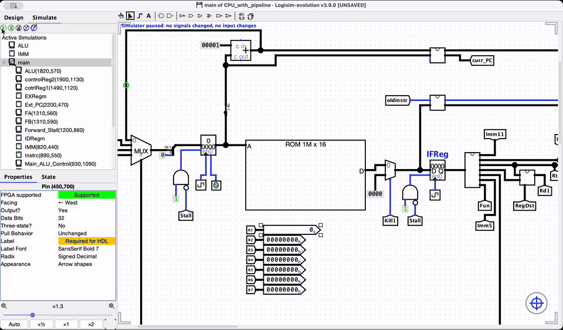
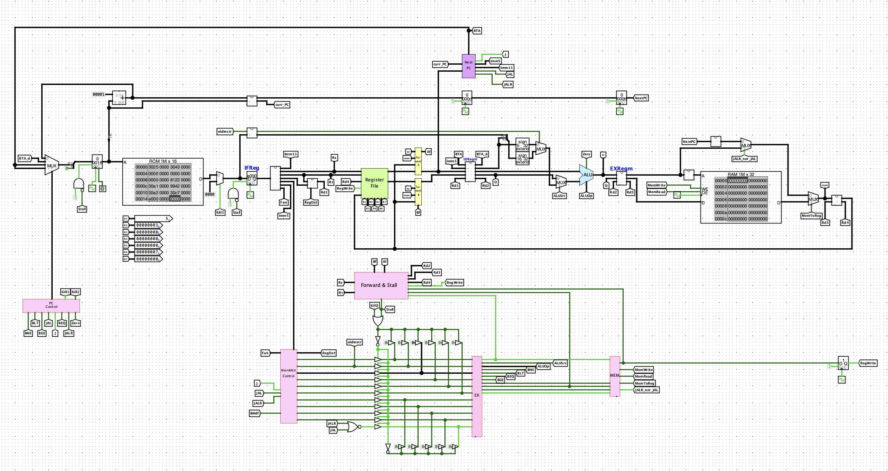

# Pipelined 32-bit CPU in Logisim-evolution

A 5-stage pipelined RISC processor with 16-bit instructions and seven 32-bit registers, designed gate- and register-level in Logisim-evolution for COE 301 (Computer Organization) at King Fahd University of Petroleum & Minerals.



## Overview

We were given only the instruction-set specification and designed the whole processor ourselves. We built a single-cycle version first, then converted it into a pipeline. Both versions passed every lab test case.

| | |
| --- | --- |
| Data width | 32 bits |
| Instruction width | 16 bits (PC advances by 2) |
| Registers | R1–R7, with R0 hardwired to zero |
| Pipeline | 5 stages: fetch, decode, execute, memory, write-back |
| Hazards | Forwarding and stall unit for data hazards; flushing for branches and jumps |
| Memories | Separate instruction ROM and data RAM |

## Datapath



The pink blocks are the control units (main and ALU control, PC control, forwarding and stall), and the narrow registers between stages are the pipeline registers.

## Instruction set

Three formats: R-type (opcode, a, b, d, function), I-type (opcode, a, b, 5-bit immediate) and J-type (opcode, 11-bit immediate).

| Group | Instructions |
| --- | --- |
| R-type ALU | AND, CAND, OR, XOR, ADD, NADD, SEQ, SLT |
| I-type ALU | ANDI, CANDI, ORI, XORI, ADDI, NADDI, SEQI, SLTI |
| Shift and rotate | SLL, SRL, SRA, ROR |
| Branches | BEQ, BNE, BLT, BGE |
| Memory | LW, SW |
| Jumps | J, JAL, JALR |
| Immediate extension | IMM |

`IMM` is not executed on its own. When it follows an I-type instruction, the decode stage joins its 11 bits with the 5-bit immediate to make one 16-bit constant.

## Running the demo

1. Open `CPU_with_pipeline.circ` in [Logisim-evolution](https://github.com/logisim-evolution/logisim-evolution) 3.9 or later.
2. The instruction ROM already holds the Fibonacci program. To load it again, or another program, right-click the ROM, choose **Load Image**, and select a file from `programs/`.
3. Choose **Simulate → Reset Simulation**, then **Simulate → Ticks Enabled**.
4. Watch the register outputs. R1 counts 1, 1, 2, 3, 5, 8 … and stops at 55 (`0x37`), with R2 = 89 (`0x59`) and R3 = 0.

The annotated program is in `programs/fibonacci.asm`.

## Repository layout

```
CPU_with_pipeline.circ    Logisim-evolution design (top level: main)
programs/
  fibonacci.asm           annotated demo program
  fibonacci_rom.txt       ROM image for Logisim (Load Image)
docs/
  demo.gif                the demo running
  datapath.png            full datapath
```

## Authors

- Norah Alshahrani ([GitHub](https://github.com/alshahrani-n))
- Zainab Aldagdoug ([LinkedIn](https://www.linkedin.com/in/zainab-aldagdoug-11b5443b0))

COE 301, Computer Organization, King Fahd University of Petroleum & Minerals.
